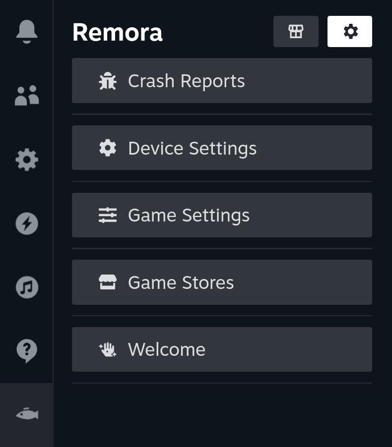
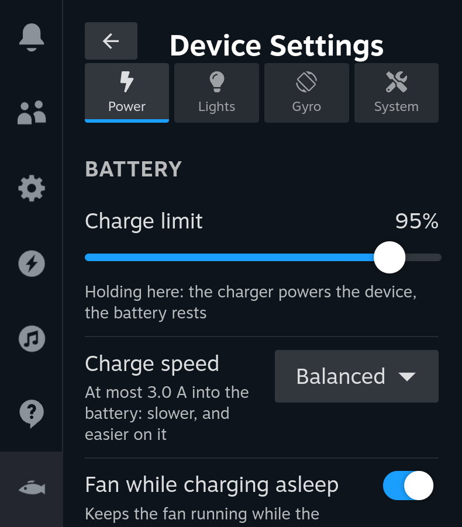
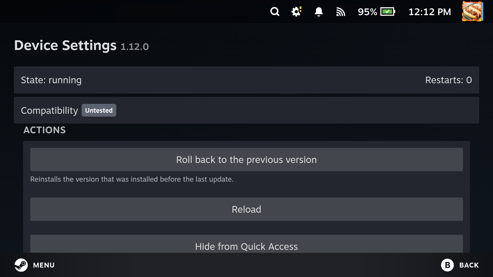
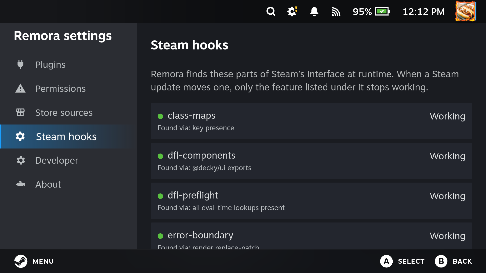
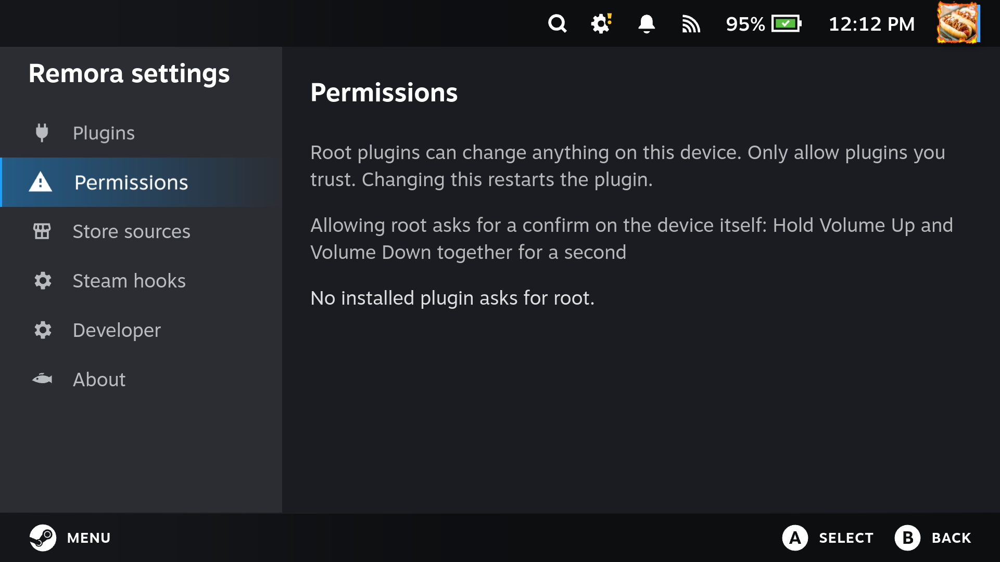
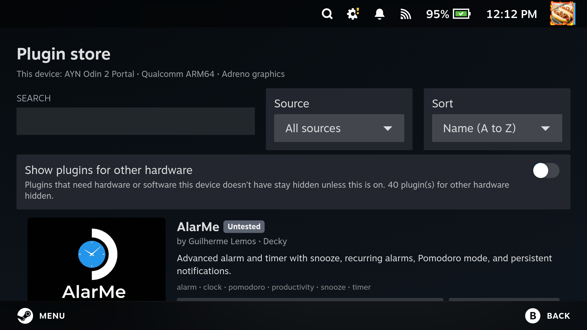
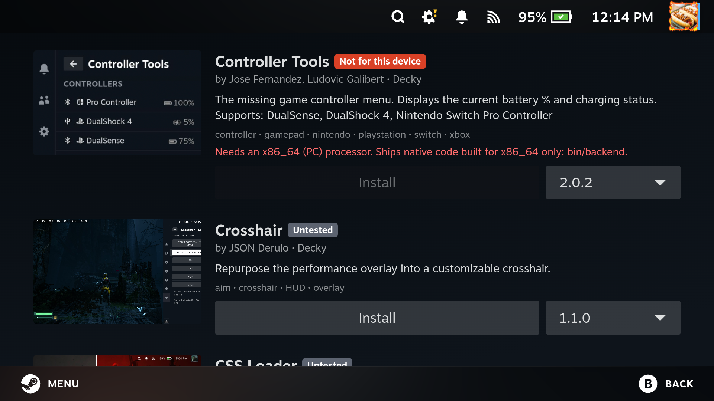
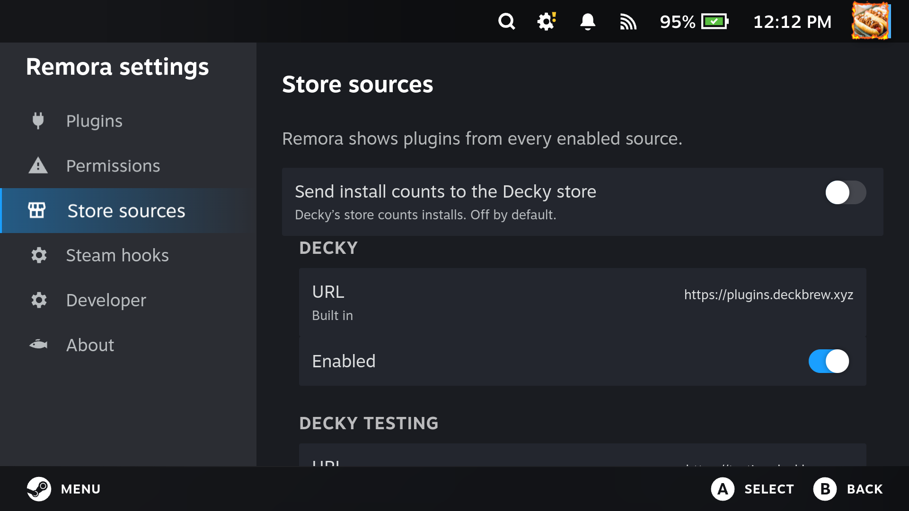
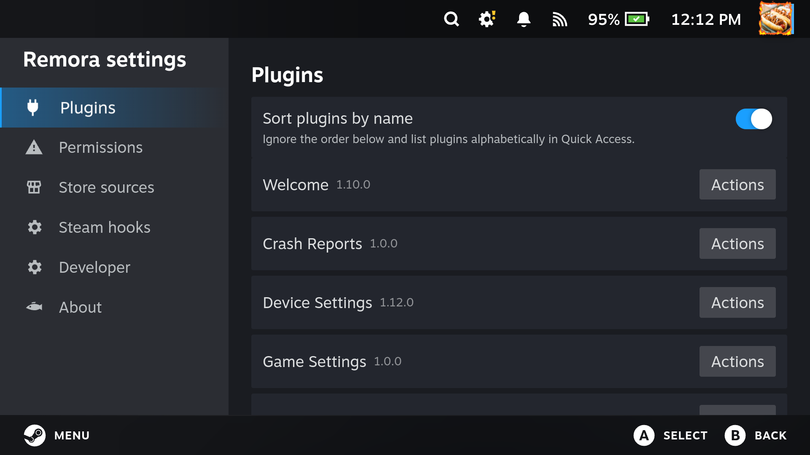

# Remora

A plugin loader for Steam's Game Mode that runs existing Decky Loader plugins unchanged, built to
be harder to break, safer to run, and open to more than one store.

Remora is a clean-room rewrite. Plugins use the same APIs as with Decky (`@decky/api`,
`@decky/ui`, the `decky` Python module, the legacy `ServerAPI`), and it keeps Decky's folders, unit
name and port. So it drops in where Decky was, and your plugins and their settings stay where they
are.

## Features

### Plugins keep running

- Every plugin backend runs in its own process. If one crashes, Remora restarts it with backoff,
  and the other plugins and the loader keep running.
- When a Steam update moves a part of Steam's interface Remora hooks into, only the feature that
  needs that part stops working. **Steam hooks** in the settings shows which one.
- Updates are staged and swapped in atomically, and the previous version is kept, so you can roll
  back to it from the plugin's page.

  
  

### Root needs your hands on the device

- Plugins run as you, not as root. A plugin that asks for root runs as root only after you approve
  it, and the approval has to come from the device itself.
- On Kettle Linux you hold Volume Up and Volume Down. Elsewhere it's the device's own keys, or
  `sudo remora approve` in a terminal.
- Anything that can click through Steam's UI can't grant root, because a click is never enough.
- The loader's token reaches Steam only through its injection, so no other program on the device
  can fetch it. Requests from web pages are refused.
- Installs are checked against their SHA-256 hash and, for signed sources, an ed25519 signature.

### A store that knows your hardware

- Remora knows what the device is: CPU type and vendor, GPU, whether it's a Steam Deck, Flatpak,
  and which Python modules are installed.
- Plugins that can't work on the device are hidden, with a toggle to show them. Examples: plugins
  that ship x86_64 programs, need Steam Deck hardware, or import Python modules the system doesn't
  have.
- Every plugin shows a badge (works, partly works, untested, not for this device) and says why.
- Before an install, Remora looks at the programs inside the plugin. If the plugin's code uses one
  built for another CPU, the install stops, even for plugins no list knows about yet. Developer
  mode can install anyway.

The requirements come from `tools/compat-scan.py`, which inspects every plugin in a Decky-format
store, plus a review of each plugin's code. Distributions add their own test results as overlays
in `/usr/share/remora/compat.d/`.

### Open store

- The Decky store is built in, and you can add your own sources. A source can be another
  Decky-format server, or a static index file you host anywhere, signed with your own key.
- Install counts are sent to the Decky store only if you turn that on.

### Nice to develop for

- `remora dev <plugin folder>` runs a local loader with just that plugin, and reloads it when its
  files change.
- `remora call <plugin folder> <method> [args]` calls one backend method, without Steam or the
  server.
- Typed stubs for the `decky` module are in [sdk/](sdk/README.md), and the protocol is documented
  in [docs/PROTOCOL.md](docs/PROTOCOL.md).

## Status

Remora is in testing on [Kettle Linux](https://github.com/kettlelinux), on an AYN Odin 2 Portal,
where it replaces Decky. Kettle's own plugins, the Decky store, toasts, crash restarts and root
approval all work there. On SteamOS and Bazzite, `packaging/steamos/install.sh` installs it in
place of Decky, and `uninstall.sh` goes back. The screenshots are from that Portal.

## Documentation

- [ARCHITECTURE.md](docs/ARCHITECTURE.md): how the loader, plugin hosts, store and frontend fit
  together
- [PROTOCOL.md](docs/PROTOCOL.md): HTTP, WebSocket routes and events, compat lists
- [DEVELOPING.md](docs/DEVELOPING.md): setup, tests, running it locally and against Steam
- [FRONTEND.md](docs/FRONTEND.md), [TESTING.md](docs/TESTING.md)
- [docs/compat/](docs/compat/README.md): the Decky behaviour Remora matches
- [packaging/](packaging/README.md): the systemd unit, the Arch package and the SteamOS installer

## License

MIT, see [LICENSE](LICENSE). `@decky/ui`, which Remora loads unmodified for plugin compatibility,
keeps its own LGPL-2.1 license.

Remora is an independent project, not affiliated with Steam Deck Homebrew or Valve.
